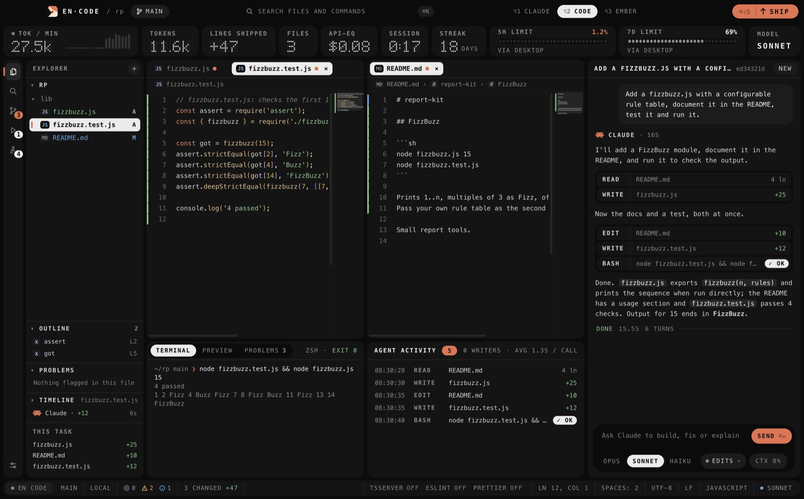
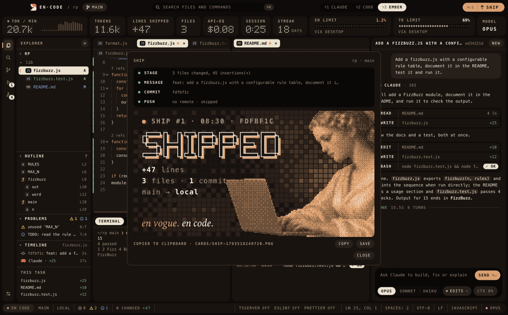
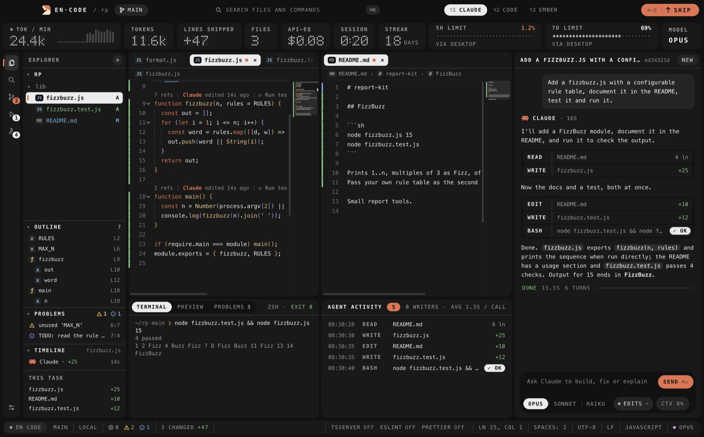

# EN·CODE

A desktop editor built around Claude Code. You ask for a change in the side panel and watch it happen: edits type themselves into the open files, tool calls stream into an activity log, and a strip along the top tracks tokens, lines shipped and your usage limits. When the work is done, Ship stages, commits and pushes it, then hands you a card to post.

## Features

- Claude's edits play back live in the editor, with split panes, an outline, problems and a per-file timeline of who changed what.
- Agent activity log and a terminal that shows each command Claude runs.
- Live stats: tokens per minute, lines shipped, API-equivalent cost, session time, streak, and the 5-hour and weekly limits.
- Switch models with ⌘1 / ⌘2 / ⌘3 (Opus, Sonnet, Haiku) and themes with ⌥1 / ⌥2 / ⌥3.
- ⌘S ships: stage, commit and push in one go, and get a SHIPPED card copied to the clipboard.
- Three Dock icons to pick from in the command palette (⌘K).

## Install

Needs an Apple silicon Mac and [Claude Code](https://docs.anthropic.com/en/docs/claude-code) installed and signed in.

1. Download `EN-CODE.zip` from the [latest release](../../releases/latest) and move the app to Applications.
2. It isn't notarized yet, so right-click it and choose Open the first time.
3. Open a project folder (⌘O) and ask Claude for something (⌘L).

## License

Free to use, not open source. See [LICENSE](LICENSE).
